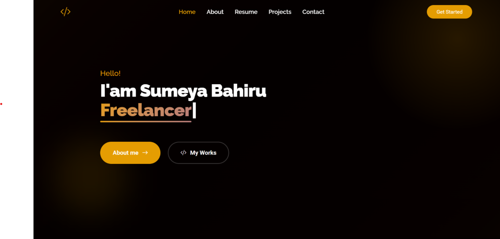

<div align="center">

# Sumeya Bahiru | Full-Stack Developer Portfolio

An interactive portfolio introducing my work, skills, projects, and engineering journey.

[](https://react.dev/)
[](https://vite.dev/)
[](https://tailwindcss.com/)
[](https://developer.mozilla.org/en-US/docs/Web/JavaScript)

[GitHub](https://github.com/Sumeya6) | [LinkedIn](https://www.linkedin.com/in/sumeya-bahiru-4287512a9)

</div>

## Overview

This repository contains my responsive personal portfolio, built with React and Vite. It presents my background as an Electrical and Computer Engineering student and full-stack developer, along with selected work and ways to get in touch.

## Preview



## Features

- **Single-page portfolio** with Home, About, Resume, Projects, and Contact sections.
- **Interactive project discovery** that guides visitors through an idea-to-impact journey and highlights selected projects.
- **Project gallery** with descriptions, technology tags, previews, and available repository or demo links.
- **Responsive navigation** with active-section tracking and a mobile menu.
- **Dark and light themes** with a matching hero background for each theme.
- **Animated interface** with reduced-motion preferences respected.
- **Skills and experience content** presented alongside a profile introduction.
- **Contact form powered by EmailJS** when configured. Without EmailJS settings, the form displays a direct email link instead.
- **Accessibility details** including keyboard-operable project selection, focus styles, and reduced-motion support.

## Technology

| Area | Technologies |
| --- | --- |
| UI | React, JavaScript |
| Development and build | Vite |
| Styling | Tailwind CSS 4 |
| Animation | Motion |
| Icons | Lucide React, React Icons |
| Contact form delivery | EmailJS |
| Hero text effect | Typewriter Effect |

## Run locally

### Prerequisites

- Node.js `^20.19.0` or `>=22.12.0`
- npm

### Install and start

```bash
git clone https://github.com/Sumeya6/Personal-Portfolio.git
cd Personal-Portfolio
npm ci
npm run dev
```

Vite prints a local development URL in the terminal when the server is ready.

### EmailJS configuration (optional)

The portfolio itself runs without EmailJS configuration. To enable message delivery from the contact form, provide these Vite environment variables:

| Variable | Purpose |
| --- | --- |
| `VITE_EMAILJS_SERVICE_ID` | EmailJS service identifier |
| `VITE_EMAILJS_TEMPLATE_ID` | EmailJS template identifier |
| `VITE_EMAILJS_PUBLIC_KEY` | EmailJS public key |

The repository includes [.env.example](.env.example) with the expected variable names. For local development, create a local `.env` file based on it and fill in the values from your EmailJS account. Keep local environment files out of commits; note that the current `.gitignore` does not exclude `.env` by default. If the variables are unset, the contact form offers a direct email fallback.

## Available scripts

| Command | Description |
| --- | --- |
| `npm run dev` | Start the Vite development server |
| `npm run lint` | Run ESLint |
| `npm run build` | Create the production build in `dist/` |
| `npm run preview` | Preview the production build locally |

## Build and deployment

Create and preview a production build:

```bash
npm run build
npm run preview
```

The generated static site is in `dist/`. Deploy that directory to a static hosting provider of your choice and configure the EmailJS variables in the provider's build environment if you want the contact form enabled. This repository does not include provider-specific deployment configuration or AWS infrastructure; no AWS deployment is documented here.

## Project structure

```text
.
|-- public/                 # Public static assets
|-- src/
|   |-- assets/images/      # Hero, profile, and project images
|   |-- components/         # Portfolio sections and reusable UI
|   |-- context/            # Theme context and provider
|   |-- data/               # Navigation, skills, projects, resume, contact
|   |-- hooks/              # Shared React hooks
|   |-- App.jsx             # Page composition
|   |-- index.css           # Tailwind import and global theme styles
|   `-- main.jsx            # React entry point
|-- .env.example            # EmailJS environment variable names
|-- index.html
|-- package.json
`-- vite.config.js
```

## About me

I'm Sumeya Bahiru, an Electrical and Computer Engineering student and full-stack developer. I focus on backend development: building REST APIs, working with databases, and designing reliable application architectures. I also enjoy bringing complete, user-focused applications together with modern frontend tools.

- **GitHub:** [github.com/Sumeya6](https://github.com/Sumeya6)
- **LinkedIn:** [linkedin.com/in/sumeya-bahiru-4287512a9](https://www.linkedin.com/in/sumeya-bahiru-4287512a9)
- **Email:** [sumeyabahiru98@gmail.com](mailto:sumeyabahiru98@gmail.com)
